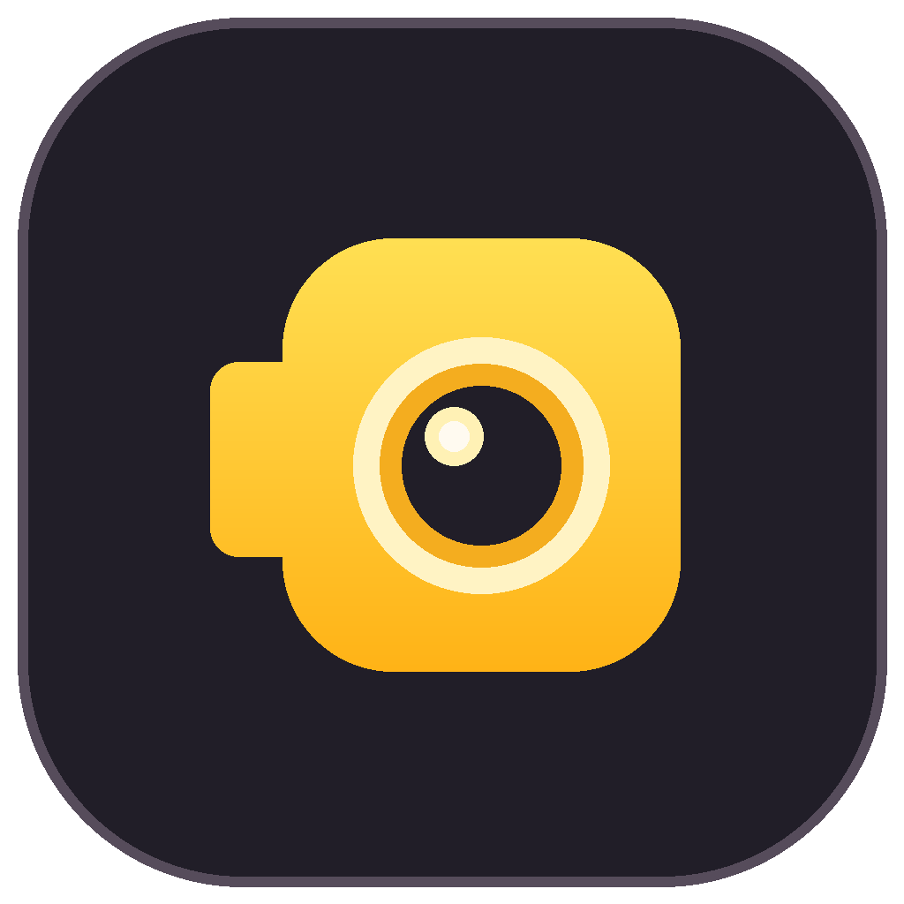
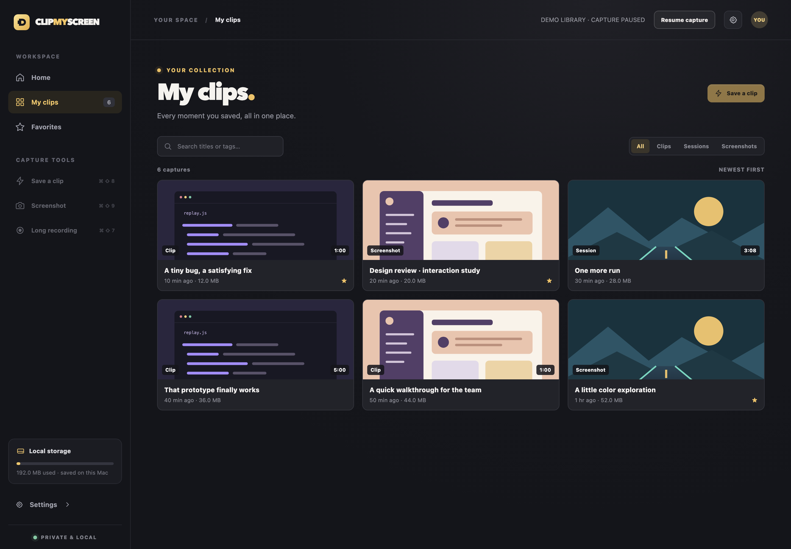
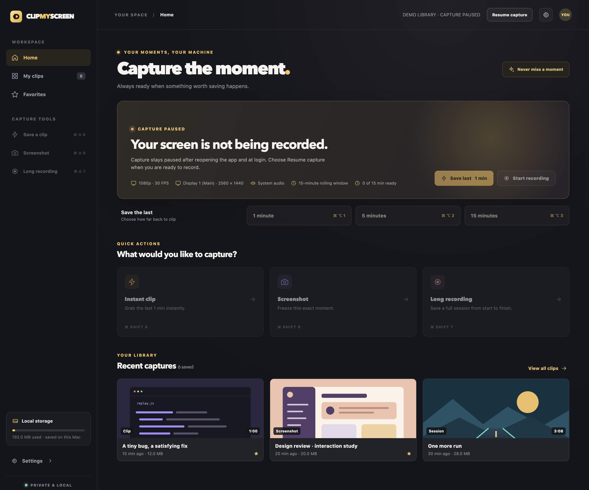
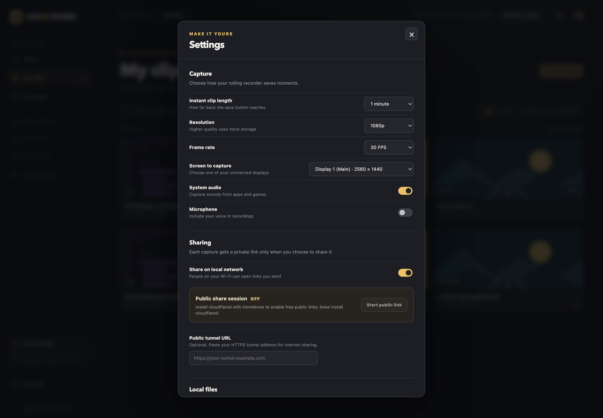

<div align="center">
  
  <h1>Clip My Screen</h1>
  <p><strong>The good bit already happened. Save it anyway.</strong></p>
  <p>A free, open-source instant replay tool for Mac and Windows.<br>Keep the last 15 minutes close. Keep your captures on your computer.</p>
  <p>
    <a href="https://github.com/nascarjake/clip-my-screen/releases/latest">Download</a> ·
    <a href="#your-first-clip">Quick start</a> ·
    <a href="#keyboard-shortcuts">Shortcuts</a> ·
    <a href="https://jakedoesdev.com/lab/#clip-my-screen">AI Lab</a> ·
    <a href="CONTRIBUTING.md">Contribute</a>
  </p>
  <p>
    <a href="https://github.com/nascarjake/clip-my-screen/releases/latest"></a>
    <a href="LICENSE"></a>
    <a href="https://github.com/nascarjake/clip-my-screen/actions/workflows/release.yml"></a>
  </p>
</div>



*The real app interface with illustrative demo captures. These screenshots contain no personal screen recordings.*

## Why Clip My Screen?

A bug finally reproduces. A teammate explains something perfectly. A game does something worth keeping. You shouldn't need to predict the moment before you can save it.

When you choose to enable capture, Clip My Screen keeps a rolling replay buffer on your computer. Press a shortcut to save the last **1, 5, or 15 minutes**, then find it in your own library. There is no account, subscription, or required cloud upload.

- **Save what just happened.** Global shortcuts, a configurable default clip length, and a menu-bar/system-tray companion.
- **Keep a useful library.** Search, rename, tag, favorite, and trim captures without leaving the app.
- **Capture your way.** Pick a display, take a screenshot, or start a longer recording. Choose 720p through 4K and 24/30/60 FPS in Settings.
- **Share deliberately.** Create a revocable link for a saved capture. Local-network sharing works without a cloud account; internet sharing is optional.
- **Stay in control.** Capture starts paused. Pause survives reopening and login. Your operating system's recording indicators stay visible during capture.

## Download

Choose your computer below. These links always point to the latest release.

| Computer | Recommended download | Also available |
| --- | --- | --- |
| **Mac · Apple Silicon** — M1 or newer, macOS 15+ | [Download Mac DMG](https://github.com/nascarjake/clip-my-screen/releases/latest/download/Clip-My-Screen-macOS-arm64.dmg) | [ZIP](https://github.com/nascarjake/clip-my-screen/releases/latest/download/Clip-My-Screen-macOS-arm64.zip) |
| **Mac · Intel** — macOS 15+ | [Download Intel Mac DMG](https://github.com/nascarjake/clip-my-screen/releases/latest/download/Clip-My-Screen-macOS-x64.dmg) | [ZIP](https://github.com/nascarjake/clip-my-screen/releases/latest/download/Clip-My-Screen-macOS-x64.zip) |
| **Windows · Intel/AMD 64-bit** — Windows 10/11 | [Download Windows installer](https://github.com/nascarjake/clip-my-screen/releases/latest/download/Clip-My-Screen-Windows-x64-Setup.exe) | [Portable EXE](https://github.com/nascarjake/clip-my-screen/releases/latest/download/Clip-My-Screen-Windows-x64-Portable.exe) |

[All releases and release notes](https://github.com/nascarjake/clip-my-screen/releases) · [SHA-256 checksums](https://github.com/nascarjake/clip-my-screen/releases/latest/download/SHA256SUMS.txt)

**Early-release signing status:** Mac builds are ad-hoc signed and unnotarized; Windows builds are unsigned. Your OS may block or warn about these downloads because they do not have a trusted publisher identity. No quarantine-removal or security-bypass script is included. If your security policy blocks the download, the source-build instructions are below. Trusted publisher signing and Mac notarization are on the roadmap.

## Your first clip

1. **Install.** On Mac, open the DMG and drag **Clip My Screen** to **Applications**. On Windows, run **Setup.exe** and follow the installer, or keep the portable EXE in a permanent folder.
2. **Open the app.** Capture begins **paused**. Nothing is recorded until you choose **Resume capture**.
3. **Mac: authorize screen recording.** In System Settings → Privacy & Security → Screen & System Audio Recording, enable Clip My Screen's capture helper. If it isn't listed, use **+** and select `/Applications/Clip My Screen.app/Contents/Resources/Clip My Screen Capture.app` (use **⌘ ⇧ G** in the file picker to enter the path). Reopen the app after changing permission. Microphone audio is optional and requires existing microphone authorization; first-time microphone setup isn't automated yet.
4. **Choose your display.** Open Settings to select your screen, resolution, frame rate, and default clip length. Windows capture is currently **video-only**; system and authorized microphone audio are supported on Mac.
5. **Resume capture, then save.** Press **⌘ ⌥ 1** on Mac or **Ctrl Alt 1** on Windows to save the last minute. The library shows the result. A full 15-minute replay is available after 15 minutes of uninterrupted capture.

Closing the window keeps the app in the menu bar or notification area. Use that icon to reopen, pause/resume, save a replay, or **Quit** completely. Installed builds register launch at login using the OS's supported login-item API; manage it in macOS Login Items or Windows Startup Apps. The app retains the saved pause/capture preference at login.



## Keyboard shortcuts

| Action | Mac | Windows |
| --- | --- | --- |
| Save last **1 minute** | `⌘ ⌥ 1` | `Ctrl Alt 1` |
| Save last **5 minutes** | `⌘ ⌥ 2` | `Ctrl Alt 2` |
| Save last **15 minutes** | `⌘ ⌥ 3` | `Ctrl Alt 3` |
| Save the default clip length | `⌘ ⇧ 8` | `Ctrl Shift 8` |
| Take a screenshot | `⌘ ⇧ 9` | `Ctrl Shift 9` |
| Start / stop a long recording | `⌘ ⇧ 7` | `Ctrl Shift 7` |

Capture actions require capture to be enabled. Changing displays starts a fresh replay buffer. If another app owns a shortcut, use the dashboard or tray controls.

## Your files. Your choice to share.

Captures are stored in `~/Movies/Clip My Screen` on Mac or `Videos/Clip My Screen` on Windows. The rolling buffer is temporary; saved clips remain until you delete them. Long recordings can continue growing until you stop them.

A saved capture only gets a share link when you create one. Local links work while the app is running and local-network sharing is enabled. Anyone with the link can view that capture; you can revoke it. Links require the originating computer to stay reachable.

For sharing beyond your network, Settings can start a temporary [Cloudflare Quick Tunnel](https://developers.cloudflare.com/cloudflare-one/networks/connectors/cloudflare-tunnel/do-more-with-tunnels/trycloudflare/) when `cloudflared` is installed, or accept your own HTTPS tunnel URL. An internet share passes through your chosen tunnel provider. The address changes when a Quick Tunnel restarts. The dashboard and management API are restricted to local requests.

<details>
<summary><strong>See capture and sharing settings</strong></summary>



</details>

## Build from source

You need **Node.js 22+** and either **macOS 15+ with Xcode Command Line Tools** or **Windows 10/11 x64 with PowerShell**. Linux is not a supported capture platform.

```sh
git clone https://github.com/nascarjake/clip-my-screen.git
cd clip-my-screen
npm ci
```

**Mac**

```sh
npm run build:native
bash scripts/fetch-ffmpeg-mac.sh
npm run desktop
# Build the DMG and ZIP for this Mac's architecture:
npm run package:mac
```

**Windows**

```powershell
pwsh -NoProfile -File scripts/fetch-ffmpeg-win.ps1
npm run desktop
# Build both the installer and portable EXE:
npm run package:win
```

Builds appear in `dist/`. Mac Apple Silicon and Intel packages are built on their respective architectures; Windows packages are built on Windows. FFmpeg downloads are pinned and checksum-verified. Release automation runs the tests and a packaged-app smoke check with capture disabled on all three build runners before publishing the downloads.

```sh
npm test                 # Fake-helper service tests and unit checks; no screen capture
npm run validate:paused  # Check a packaged app with temporary data, capture off, no login registration
npm run docs:screenshots # Render the real UI with demo fixtures; no desktop capture or personal library
```

## Where the project is today

Clip My Screen is an early open-source desktop app. Mac uses ScreenCaptureKit; Windows uses FFmpeg desktop capture. Recent work reduces Mac output rotation frequency, lowers the configured frame queue, improves helper shutdown, limits replay retention, and uses hardware-assisted Mac exports with a bounded software fallback.

The automated tests and paused-app checks **do not** establish real-world capture performance. Live capture continuity, audio sync, long-running resource use, and the reported Finder privacy-indicator behavior still need real-device validation. See [performance notes](docs/performance.md) for the measured synthetic export comparison and its limits.

Next up: trusted publisher signing/notarization, first-time microphone permission setup, more real-device capture tests, and Windows audio capture. There is no webcam overlay, per-game detection, built-in cloud library, or social feed.

## Build it with me

Bug reports, careful performance measurements, accessibility improvements, translations, and small focused pull requests are welcome. Start with [CONTRIBUTING.md](CONTRIBUTING.md), [open an issue](https://github.com/nascarjake/clip-my-screen/issues/new/choose), or pick something from the roadmap above. For security issues, see [SECURITY.md](SECURITY.md).

Created by [JakeDoesDev](https://jakedoesdev.com). Explore this project and other experiments in the [AI Lab](https://jakedoesdev.com/lab/#clip-my-screen).

## License and credits

The app's source is [MIT licensed](LICENSE). Electron and other dependencies retain their own licenses. Packaged releases include a GPLv3 FFmpeg distribution invoked as a separate process, with its license texts and corresponding-source notice bundled in the app's Resources directory. See [third-party notices](THIRD_PARTY_NOTICES.md) for the pinned distribution and source links.
